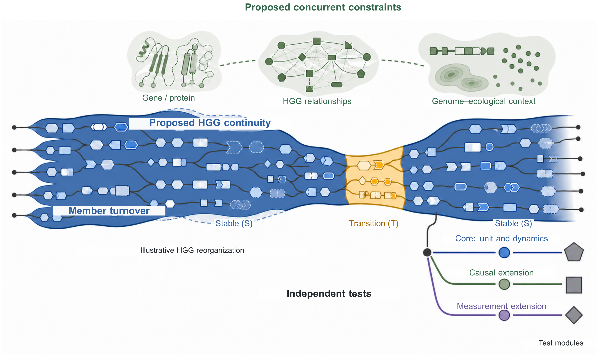

# The Ghost in the Genome

## High-Dimensional Constraints and the Bi-state Dynamics of Homologous Gene Groups

**Author:** Xianwen Meng  
**Affiliation:** School of Information Engineering, Yulin University, Yulin, Shaanxi, 719000, China

**Current version:** 2.0  
**Revision date:** 15 November 2026

---

## Overview

This repository hosts the conceptual synthesis and hypothesis framework on homologous gene groups (HGGs), their bi-state evolutionary dynamics, concurrent multi-layer constraints, and the potential use of protein language models (PLMs) as measurement tools.

The framework asks whether homologous gene groups can retain historical continuity despite duplication, loss, divergence, and reorganization of individual members, and whether this continuity provides explanatory value beyond established evolutionary units and models.

## Current manuscript

**Version 2.0 — Revised 15 November 2026**

[**Read the full manuscript (PDF)**](Ghost_in_the_Genome_v2.0.pdf)

This revised version develops four interconnected components:

1. **HGG as a candidate evolutionary unit:** historical anchoring, cross-lineage traceability, and organizational coherence.
2. **Bi-state evolutionary dynamics:** stable and transition regimes, with establishment, reorganization, and extinction as transition endpoints.
3. **Concurrent multi-layer constraints:** gene-level, HGG-level, and genome–ecological influences.
4. **Protein language models:** an optional measurement extension, evaluated against sequence, profile, structural, phylogenetic, and sampling-related alternatives.

The manuscript provides explicit predictions, competing explanations, validation strategies, and rejection criteria.

The proposed framework remains a conceptual synthesis and hypothesis framework. Genome-wide, multispecies empirical validation remains outstanding.

## Figures

The five main figures and graphical abstract are available below.

- [Figure 1. Candidate HGG construction](figures/figure_01_hgg_unit_labeled.png)
- [Figure 2. Bi-state evolutionary dynamics](figures/figure_02_bistate_labeled.png)
- [Figure 3. Concurrent multi-layer constraints](figures/figure_03_constraints_labeled.png)
- [Figure 4. Protein language-model representations](figures/figure_04_representation_labeled.png)
- [Figure 5. Falsification and validation framework](figures/figure_05_falsification_labeled.png)
- [Graphical abstract](figures/graphical_abstract.png)

### Graphical abstract

## Version history

- **Version 1.0 — 13 February 2026:** Initial public release of the HGG conceptual framework.
- **Version 2.0 — 15 November 2026:** Expanded literature synthesis, refined HGG operational criteria, developed bi-state hypotheses, and added a comprehensive falsification and validation framework.

The original version is retained for historical reference.

## Archival record

The manuscript is archived on Zenodo with version-specific and concept DOIs.

- **Current version (v2.0):** [10.5281/zenodo.24247423](https://doi.org/10.5281/zenodo.24247423)
- **Concept DOI (all versions):** [10.5281/zenodo.18626930](https://doi.org/10.5281/zenodo.18626930)
- **Original version (v1.0):** [10.5281/zenodo.18626931](https://doi.org/10.5281/zenodo.18626931)

The Concept DOI represents all versions of this work and resolves to the latest version. Each version-specific DOI permanently identifies its corresponding archived version.

### Related links

- [GitHub repository](https://github.com/menglab/ghost-in-the-genome)
- [GitHub releases](https://github.com/menglab/ghost-in-the-genome/releases)
- [Zenodo Version 2.0 record](https://zenodo.org/records/24247423)
- [ResearchGate publication](https://www.researchgate.net/publication/400798060_The_Ghost_in_the_Genome_High-Dimensional_Constraints_and_the_Bi-state_Dynamics_of_Homologous_Gene_Groups)

## License

The original repository materials are distributed under the Creative Commons Attribution 4.0 International License (CC BY 4.0), as specified in the LICENSE file. Third-party materials retain their respective rights.

## Citation

Please cite the specific version when referencing this work.

**Version 2.0:**

Meng X. (2026). *The Ghost in the Genome: High-Dimensional Constraints and the Bi-state Dynamics of Homologous Gene Groups*. Version 2.0. Zenodo. https://doi.org/10.5281/zenodo.24247423

**All versions:**

Meng X. (2026). *The Ghost in the Genome: High-Dimensional Constraints and the Bi-state Dynamics of Homologous Gene Groups*. Zenodo. https://doi.org/10.5281/zenodo.18626930
